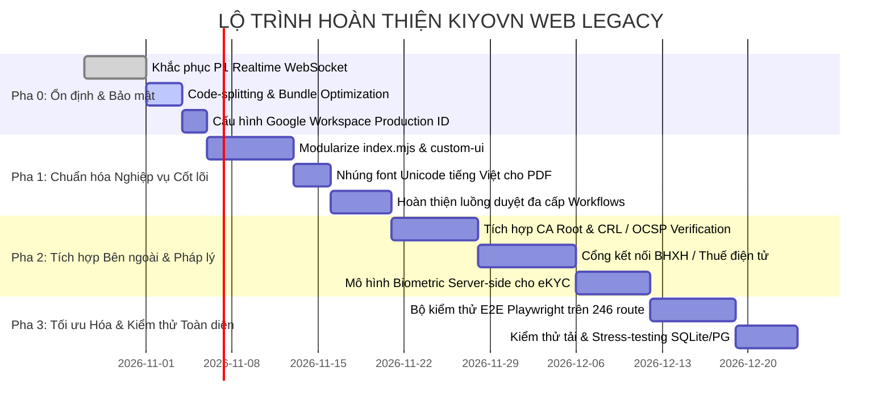

# KẾ HOẠCH HOÀN THIỆN HỆ THỐNG VÀ LỘ TRÌNH TRIỂN KHAI (ROADMAP)

Tài liệu này định hình lộ trình kỹ thuật cụ thể theo các pha để đưa toàn bộ hệ thống KIYOVN Web Legacy từ trạng thái hiện tại (78.2% xác minh) đạt **100% phạm vi nghiệp vụ sẵn sàng vận hành sản xuất (Production-Ready)**.

---

## I. MA TRẬN CÁC PHA TRIỂN KHAI

---

## II. CHI TIẾT CÁC TÁC VỤ ƯU TIÊN THEO PHA

### Pha 0: Ổn định nền tảng & Khắc phục rủi ro P1 (Blockers)

| Task ID | Module | Mô tả công việc | Độ ưu tiên | Độ khó | Tiêu chí nghiệm thu | Rủi ro |
|---|---|---|:---:|:---:|---|---|
| **TASK-01** | Chat | Thay thế `MockChatSocket` bằng máy chủ WebSocket thật (Node `ws` hoặc Socket.io) | **P1** | Vừa (3 SP) | Hai trình duyệt khác nhau gửi và nhận tin nhắn, tệp đính kèm theo thời gian thực không cần tải lại trang. | Quản lý kết nối rớt mạng và đồng bộ trạng thái online. |
| **TASK-02** | Web Core | Thiết lập Dynamic `import()` & Code Splitting cho Vite | **P1** | Nhỏ (2 SP) | Kích thước bundle chính dưới 500 KB gzip; mỗi route tải chunk riêng khi điều hướng. | Cache hash thay đổi khi cập nhật phiên bản. |
| **TASK-03** | Auth | Thiết lập cấu hình biến môi trường Google Client ID thật | **P1** | Nhỏ (1 SP) | Xác thực token RS256 trực tiếp từ Google Discovery Document trong môi trường staging/production. | Lệ thuộc vào domain Google Workspace của khách hàng. |
| **TASK-04** | eKYC | Thay thế thuật toán pixel diff bằng mô hình ONNX / FaceNet cục bộ | **P1** | Cao (5 SP) | Tính toán khoảng cách Euclidean / Cosine Similarity giữa 2 vector khuôn mặt, loại bỏ ID chứng chỉ giả lập. | Hiệu năng suy luận trên máy chủ cấu hình thấp. |

---

### Pha 1: Hoàn tất luồng nghiệp vụ & Tái cấu trúc mã nguồn

| Task ID | Module | Mô tả công việc | Độ ưu tiên | Độ khó | Tiêu chí nghiệm thu | Rủi ro |
|---|---|---|:---:|:---:|---|---|
| **TASK-05** | Backend | Tách file `legacy/api/index.mjs` (5,934 dòng) thành các Router con | **P2** | Vừa (5 SP) | Chia thành thư mục `controllers/` và `routes/` theo từng domain (auth, finance, hr, attendance, files...). Giữ 100% test pass. | Xung đột đường dẫn router nếu chuyển đổi không cẩn trọng. |
| **TASK-06** | Frontend | Tách `legacy/web/src/custom-ui/index.tsx` (5,840 dòng) | **P2** | Vừa (3 SP) | Chia thành các component độc lập `Button.tsx`, `Modal.tsx`, `Form.tsx`, `Table.tsx`. | Gãy style Fluent UI nếu import sai đường dẫn. |
| **TASK-07** | Exporter | Nhúng font TrueType (Noto Sans / Roboto) vào thư viện `pdf-lib` | **P2** | Nhỏ (2 SP) | Toàn bộ tệp PDF xuất ra giữ nguyên dấu tiếng Việt có dấu Unicode, không bị chuyển thành không dấu. | Tăng nhẹ kích thước tệp PDF xuất ra (~2MB nhúng font). |
| **TASK-08** | Workflows | Nối động cơ phê duyệt đa cấp với thông báo Email SMTP và Notification | **P2** | Vừa (4 SP) | Khi nhân viên nộp đề xuất hoặc xin nghỉ phép, quản lý nhận email và thông báo trong ứng dụng kèm link duyệt trực tiếp. | Cấu hình SMTP chặn gửi thư hàng loạt. |

---

### Pha 2: Tích hợp pháp lý số & Dịch vụ công Việt Nam

| Task ID | Module | Mô tả công việc | Độ ưu tiên | Độ khó | Tiêu chí nghiệm thu | Rủi ro |
|---|---|---|:---:|:---:|---|---|
| **TASK-09** | Digital Sig | Triển khai bộ xác thực hàm băm byte-range & chứng thư số Root CA | **P2** | Cao (8 SP) | Kiểm tra tính toàn vẹn chữ ký PDF (PAdES CMS) và đối soát chuỗi chứng chỉ với Root CA quốc gia (NEAC). | Cần cập nhật định kỳ danh sách chứng chỉ Root CA Việt Nam. |
| **TASK-10** | Insurance | Tích hợp định dạng chuẩn XML nộp Cổng bảo hiểm điện tử (I-VAN) | **P2** | Cao (8 SP) | Xuất khẩu hồ sơ D02-TS, 630 dạng tệp XML đạt chuẩn kiểm tra cú pháp của BHXH Việt Nam. | Thay đổi quy chuẩn biểu mẫu từ cơ quan BHXH. |
| **TASK-11** | Banking | Tích hợp mã VietQR động theo tiêu chuẩn Napas cho các khoản thu | **P2** | Vừa (3 SP) | Tự động tạo mã QR có số tài khoản, số tiền và nội dung hóa đơn để khách hàng thanh toán quét mã. | Phụ thuộc vào tài khoản ngân hàng của doanh nghiệp. |

---

### Pha 3: Kiểm thử toàn diện & Sẵn sàng vận hành sản xuất

| Task ID | Module | Mô tả công việc | Độ ưu tiên | Độ khó | Tiêu chí nghiệm thu | Rủi ro |
|---|---|---|:---:|:---:|---|---|
| **TASK-12** | QA | Xây dựng bộ kiểm thử End-to-End Playwright cho 20 luồng nghiệp vụ chính | **P2** | Cao (5 SP) | Kiểm tra tự động luồng: Tạo nhân viên -> Ký HĐ -> Chấm công -> Tính lương -> Chuyển khoản -> Khen thưởng. | Mất nhiều thời gian chạy trên CI/CD pipeline. |
| **TASK-13** | SRE / DevOps | Kiểm thử chịu tải (Load Testing k6) trên cả SQLite WAL và PostgreSQL | **P3** | Vừa (3 SP) | Đạt ngưỡng 200 RPS với SQLite và 1,000 RPS với PostgreSQL ở độ trễ p95 < 200ms. | Nghẽn I/O đĩa cứng khi chạy SQLite nhiều luồng ghi. |
