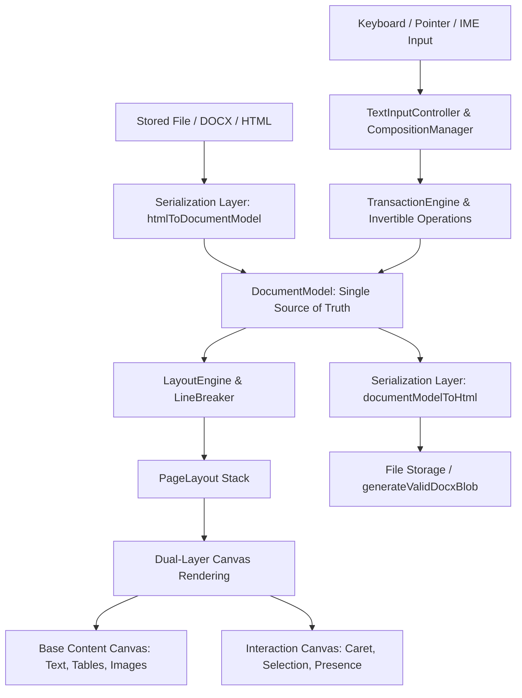

# Canvas-Based Document Editor Engine Architecture

## 1. Executive Summary

This document describes the architectural migration and implementation of the **Canvas-based Document Rendering and Editing Engine** powering the `/files/document/` route within the application.

All visual document text and content elements are now painted directly to HTML5 Canvas (Base Content Canvas + Interaction Canvas) while completely retaining 100% of the existing user interface, Microsoft Office / Google Docs ribbon toolbars, Vietnamese keyboard shortcuts, file serialization format, and data persistence workflows.

---

## 2. Core Architecture Pipeline

### 2.1 Layer Breakdown

1. **Document Data Model (`src/features/documents/editor/core/model/`)**:
   - `DocumentModel`: Structural document state represented by discrete typed blocks (`ParagraphBlock`, `HeadingBlock`, `ListItemBlock`, `TableBlock`, `ImageBlock`, `HorizontalRuleBlock`, `PageBreakBlock`).
   - Run-based formatting: Each block maintains an array of `TextRun` items with inline `TextMarks` (`bold`, `italic`, `underline`, `strike`, `fontFamily`, `fontSize`, `foregroundColor`, `backgroundColor`, `link`).
   - `serialization.ts`: High-fidelity bidirectional translation between HTML/DOCX and `DocumentModelData`.

2. **Layout & Pagination Engine (`src/features/documents/editor/core/layout/`)**:
   - `LayoutEngine`: Calculates page geometry (A4, A5, custom dimensions, margins, orientation).
   - `LineBreaker`: Word boundary splitting, text measurement via `FontMetricsService`, line wrapping, paragraph indentation, and inter-page distribution.
   - Outputs `DocumentLayout` comprising discrete `PageLayout` structures with line fragments and `hitTestIndex`.

3. **Rendering System (`src/features/documents/editor/core/renderer/` & `CanvasPage.tsx`)**:
   - **Base Content Canvas (`CanvasRenderer`)**: High-DPI (`devicePixelRatio`) rendering of text fragments, table borders/cells, images, rules, and background colors.
   - **Interaction Canvas (`InteractionRenderer`)**: Zero-content-canvas-invalidation overlay rendering for blinking carets, multi-line selection polygons, search highlights, and real-time collaborator cursors.

4. **Input, Vietnamese IME & Keyboard Bridge (`src/features/documents/editor/core/input/`)**:
   - Offscreen bridge (`<textarea className="doc-hidden-input">`).
   - `CompositionManager`: Full support for Vietnamese Telex and VNI composition (`compositionstart`, `compositionupdate`, `compositionend`) without caret misalignments or dropped diacritics.
   - `TextInputController` & `KeyboardController`: Handles keyboard shortcuts (Ctrl+B, Ctrl+I, Ctrl+U, Ctrl+Z, Ctrl+Y, Ctrl+S, Ctrl+A), arrow navigation, grapheme-aware backspacing, and paragraph splits.

5. **Transactions & History (`src/features/documents/editor/core/transactions/` & `history/`)**:
   - ACID-like atomic mutations via `TransactionEngine`.
   - Reversible operations (`insert_text`, `delete_text`, `split_block`, `merge_blocks`, `set_marks`, `set_paragraph_style`).
   - Unlimited Undo/Redo stack maintained by `HistoryManager`.

6. **Hit Testing & Selection (`src/features/documents/editor/core/hit-testing/` & `selection/`)**:
   - `HitTester`: Binary searches line fragments and cluster measurements on pointer click/drag to resolve exact document positions (`blockId`, `offset`).
   - `SelectionEngine`: Manages anchor and focus positions, active formatting mark extraction, and event bus broadcasts.

---

## 3. UI and Feature Compatibility

- **Ribbon Menus & Toolbars**: 100% unchanged. Commands dispatched through `CommandRegistry` (`toggleBold`, `setFontFamily`, `setFontSize`, `setAlignment`, `toggleList`, `insertTable`, etc.).
- **Data Persistence**: Documents load seamlessly from `getFileBlob` / `localStorage` / initial HTML and export via `documentModelToHtml` -> `generateValidDocxBlob` -> `saveFileBlob`.
- **Rulers, Zoom & Page Stack**: Page dimensions and zoom scaling (25% - 200%) render with pixel-perfect resolution.

---

## 4. Test Suite

The Canvas Document Engine includes automated unit test suites in `src/features/documents/editor/tests/`:
- **Model Tests**: Document initialization, block mutations, run normalization, run merging.
- **Transaction & History Tests**: Atomicity of operations, single-step and multi-step Undo/Redo.
- **Layout & Pagination Tests**: Page generation, hit test index population, caret geometry.
- **Vietnamese IME Tests**: Diacritics composition, grapheme cluster segmentation, Unicode multi-byte deletion.
- **Serialization Tests**: HTML <-> DocumentModel round-trip integrity across headings, marks, lists, and paragraphs.
